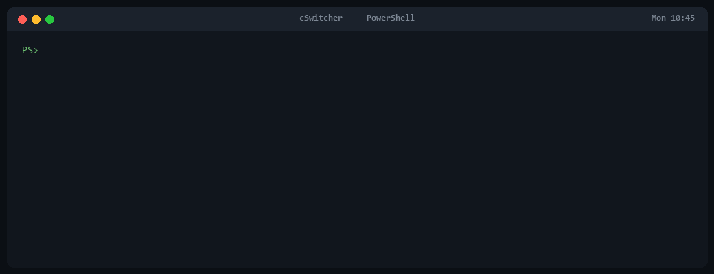
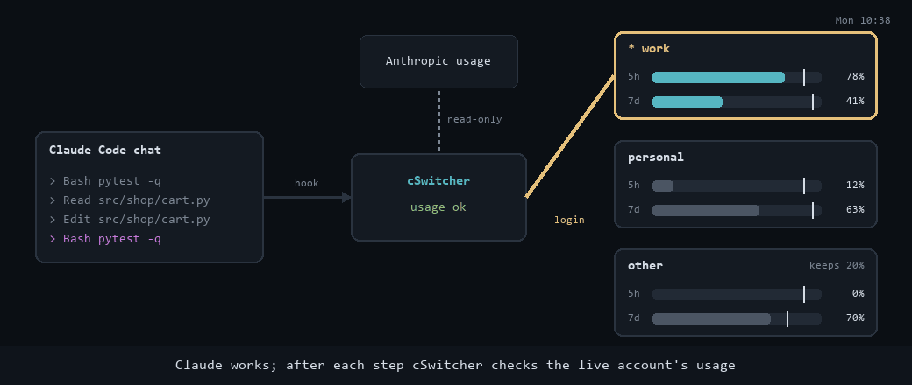
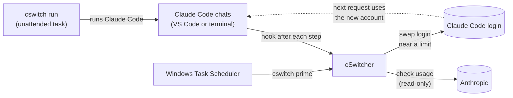

# cSwitcher

**Keep long Claude Code sessions running across several Claude subscriptions.**
If you have more than one Claude plan (say a Team seat and a personal Pro), cSwitcher moves
Claude Code to another of your accounts before a usage limit stops it, and carries
unattended tasks through the night on its own.



## Features

- **Switches before the limit.** Claude's usage comes in 5-hour windows plus a weekly limit.
  At 90% of either (95% weekly), Claude Code moves to the first account in your order that has
  room. Open chats continue on the new account with their next request.
- **Unattended runs.** `cswitch run "task"` keeps Claude working: it switches, waits for a
  reset when every account is used up, retries errors and notifies you when it's done.
- **Your priorities.** Prefer one account, switch back to it once it has room, and keep part
  of an account's week for yourself (`reserve`).
- **Fresh windows sooner.** A 5-hour window starts with your first message. cSwitcher can
  start each account's window early on a schedule (one tiny request, called *priming*), all
  at once or staggered, so a reset is never far away.
- **Set up in one go.** `cswitch setup` walks you through accounts and settings; a copy of
  the config sets up a second computer.
- **Transparent.** Every switch and prime is in `cswitch log`.

## How it works



No program stays running in the background. Claude Code calls cSwitcher through *hooks*
(commands it runs after each step, at the end of a reply and at a usage limit). cSwitcher
checks the live account's usage, at most once a minute, and near a limit swaps Claude Code's
saved login for another account's. Claude Code uses the new login with its next request.

<details>
<summary>Architecture</summary>



</details>

## Install

Requirements: Windows 10 or 11, two or more Claude plans, [Claude Code](https://claude.com/claude-code)
with its CLI (`claude` on PATH; `cswitch run` and priming use it), [uv](https://docs.astral.sh/uv/)
(`winget install astral-sh.uv`) and git. macOS is planned.

```powershell
uv tool install git+https://github.com/Romercor/cSwitcher
uv tool update-shell        # once, then open a new terminal
```

## Set up

Log in to Claude Code (`/login`) with one of your accounts, then run:

```powershell
cswitch setup
```

The wizard saves this account, then asks you to `/login` with each of your other accounts in
turn. It asks for your preferred order, an optional reserve and a priming schedule, and turns
automatic switching on. Start a new Claude Code chat afterwards (hooks load when a chat
starts). On another computer: `cswitch setup --config <copy of config.toml>`; logins are
never copied, you log in once per account there.

## Commands

| Command | What it does |
|---|---|
| `cswitch setup [--config FILE]` | guided setup; `--config` takes the settings from another computer |
| `cswitch status` | usage per account and what cSwitcher would do |
| `cswitch run "TASK"` | work on a task unattended; options: `--remote-control`, `--permission-mode MODE` (default `acceptEdits`), Claude Code options after `--` |
| `cswitch run --resume ID` | continue a stopped run (from the same folder) |
| `cswitch log [-n LINES]` | recent switches, primes and runs |
| `cswitch switch NAME` | switch by hand (kept until it nears a limit) |
| `cswitch add NAME [--new]` | save the logged-in account; `--new` signs out first for the next `/login` |
| `cswitch list` / `cswitch remove NAME` | saved accounts / delete one |
| `cswitch exclude NAME` / `include NAME` | keep an account out of / back in automatic switching |
| `cswitch prime [NAME ...]` | start 5-hour windows now |
| `cswitch schedule install` / `uninstall` | scheduled priming on / off (after `cswitch set prime_mode spread` or `together`) |
| `cswitch config` / `cswitch set SETTING VALUE...` | show / change settings |
| `cswitch install` / `uninstall` | turn the hooks on / off (`uninstall` also removes scheduled priming) |

`cswitch <command> -h` shows every option. Thresholds, order, reserve and priming are
settings: `cswitch config` shows them, `cswitch set five_hour_threshold 85` changes one. All of
them are explained in the [guide](docs/guide.md#settings).

## Good to know

- **Private by design.** Logins and settings stay in `%USERPROFILE%\.cswitcher` on your
  computer, stored unencrypted like Claude Code's own login. Tokens only ever go to
  Anthropic, through Claude Code itself or Anthropic's read-only usage and profile endpoints.
  cSwitcher never uses `/logout`, which would revoke a login.
- **Unofficial.** cSwitcher is not affiliated with Anthropic. Using several subscriptions
  this way, and automated requests such as `cswitch run` and priming, must be allowed by
  Anthropic's terms for your plans; check them before you rely on it.
- **Removing it:** see the [guide](docs/guide.md#removing-it).

Everything in detail, including overnight runs, Remote Control, priming and all settings:
**[docs/guide.md](docs/guide.md)**.

## License

[MIT](LICENSE)
